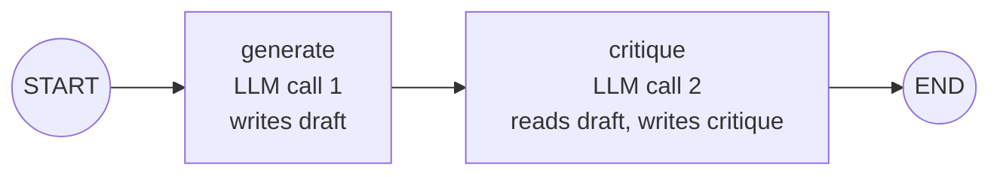
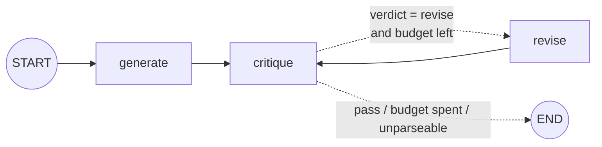
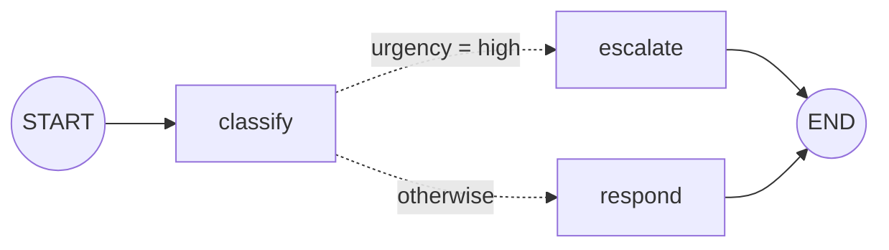

# LangGraph Two-Call Workflow — Extension Plan

Goal from the [roadmap](../../raw/roadmaps/2026-10-18-ai-infra-project-roadmap.md):
go from basic agentic state graphs to a robust **two-call workflow** with
explicit State, Nodes and Edges, and document the state schema, graph
compilation, and execution-trace handling.

**Runnable code:** [`labs/langgraph-two-call/two_call.py`](../../labs/langgraph-two-call/two_call.py)
(tests: [`test_two_call.py`](../../labs/langgraph-two-call/test_two_call.py),
notebook: [`two_call_walkthrough.ipynb`](../../labs/langgraph-two-call/two_call_walkthrough.ipynb)).
Verified against `langgraph` 1.2 on 2026-10-18: 9/9 offline tests pass, plus
a run against a local OpenAI-compatible endpoint.

Concept background: [LangGraph state graphs](../concepts/langgraph-state-graphs.md).

## Step 0 — Where you are (assumed)

> **Assumption:** your notebook wasn't in the repo or in Google Drive when this
> page was written, so the plan starts from the standard LangGraph quickstart.
> Export it to `raw/notebooks/` and run `/ingest`; the steps below get
> re-targeted to what you actually have.

```python
from typing import Annotated, TypedDict
from langgraph.graph import StateGraph, START, END
from langgraph.graph.message import add_messages

class State(TypedDict):
    messages: Annotated[list, add_messages]

def chatbot(state: State):
    return {"messages": [llm.invoke(state["messages"])]}

builder = StateGraph(State)
builder.add_node("chatbot", chatbot)
builder.add_edge(START, "chatbot")
builder.add_edge("chatbot", END)
graph = builder.compile()
graph.invoke({"messages": [("user", "hi")]})
```

What's missing for a two-call workflow: **named fields** in state (not just a
message list), a second node that *reads* the first node's output, a way to
see what each node did, and tests.

## Which pattern, and why

| Pattern | State keys | Node 1 → Node 2 | Where it pays off in the roadmap |
|---|---|---|---|
| **Generate → critique** (built here) | `question → draft → critique` | answer → structured review | [01](../projects/01-dockerfile-generator.md) generate→verify→repair; a mini LLM-judge for [06](../projects/06-sovereign-ai-engine.md) |
| **Classify → respond** (variant B, built) | `message → classification → response` | label → tailored reply, routed | [03](../projects/03-devops-aiops-platform.md) alert triage |
| Explain → summarize (variant C) | `concept → explanation → eli5` | depth → compression | Story-bank "explain it simply" drafts |
| Question → answer (variant D) | `domain → question → answer` | ask → structured answer | Interview prep from the wiki |

Generate → critique is the primary build because its second node *judges* the
first, which is the core move in both the Dockerfile agent and the Sovereign
AI evaluation.



## Step 1 — Define the State schema explicitly

```python
import operator
from typing import Annotated, Literal, TypedDict

class TraceEvent(TypedDict):
    node: str
    ms: float
    out_chars: int

class Critique(TypedDict):
    score: int                              # 1-10
    gaps: list[str]                         # what the answer leaves out
    failure_modes: list[str]                # where acting on the answer goes wrong
    verdict: Literal["pass", "revise"]

class CritiqueInput(TypedDict):             # the public contract: callers pass only this
    question: str

class CritiqueState(CritiqueInput, total=False):
    draft: str                              # written by generate (and revise)
    critique: Critique                      # written by critique
    critique_raw: str                       # raw reviewer reply, for debugging
    critique_error: str                     # set when the reply couldn't be parsed
    revisions: int
    trace: Annotated[list[TraceEvent], operator.add]   # reducer: append, never overwrite
```

Design rules:

- **One writer per key** (except `trace`). `draft` belongs to generate/revise,
  `critique` to critique. That makes the data flow readable from the schema.
- **Reducers only where several nodes write.** `trace` uses `operator.add`, so
  every node's event is appended; everything else is plain overwrite.
- **Separate input schema** (`input_schema=CritiqueInput`) so internal keys
  aren't part of what callers have to send.
- **Keep raw model output** next to the parsed value. When parsing fails you
  still have the reply in the trace.

## Step 2 — Node 1: generate

```python
GENERATE_SYSTEM = ("You are a senior AI infrastructure engineer. Answer the question accurately "
                   "and concretely in under 250 words. Prefer specifics over generalities.")

def generate(state: CritiqueState) -> dict:
    return {"draft": chat(GENERATE_SYSTEM, state["question"]), "revisions": 0}
```

A node returns **only the keys it changes**; LangGraph merges the update.
`chat` is any `(system, user) -> str` function — a real model or a test double
(Step 6). Injecting it keeps the graph testable.

## Step 3 — Node 2: critique reads Node 1's output from state

```python
CRITIQUE_SYSTEM = ("You are a demanding technical reviewer. Evaluate the answer to the question. "
                   'Return ONLY a JSON object: {"score": <1-10>, "gaps": [...], '
                   '"failure_modes": [...], "verdict": "pass" or "revise"}. Use "revise" when score < 7.')

def critique(state: CritiqueState) -> dict:
    reply = chat(CRITIQUE_SYSTEM, f"Question:\n{state['question']}\n\nAnswer to review:\n{state['draft']}")
    try:
        return {"critique": parse_critique(reply), "critique_raw": reply, "critique_error": ""}
    except (ValueError, TypeError) as exc:
        return {"critique_raw": reply, "critique_error": f"unparseable critique: {exc}"}
```

- The handoff is `state['draft']` — the second call sees exactly what the
  first produced; the test suite asserts this.
- The review is **structured** (a rubric in JSON), so later steps can route on
  it. `parse_critique` tolerates ```` ```json ```` fences and chatter, clamps the
  score, and derives a verdict if the model omits it.
- A parse failure is **recorded, not raised**: the run completes and the trace
  shows why.

## Step 4 — Wire the edges and compile

```python
from langgraph.checkpoint.memory import InMemorySaver
from langgraph.graph import END, START, StateGraph

builder = StateGraph(CritiqueState, input_schema=CritiqueInput)
builder.add_node("generate", traced("generate", generate))
builder.add_node("critique", traced("critique", critique))
builder.add_edge(START, "generate")
builder.add_edge("generate", "critique")
builder.add_edge("critique", END)
graph = builder.compile(checkpointer=InMemorySaver())

print(graph.get_graph().draw_mermaid())    # render the structure you actually compiled
```

`compile()` validates the structure (unknown nodes, dangling edges) and
returns a runnable. The checkpointer enables Step 5's state history.

## Step 5 — Execution trace handling

Three layers, from cheapest to richest:

**a) Trace in state.** `traced(name, fn)` wraps each node, times it, and
appends a `TraceEvent` via the `trace` reducer — so the final state carries its
own execution record:

```python
def traced(name, fn):
    def node(state):
        start = time.perf_counter()
        update = fn(state)
        event = TraceEvent(node=name, ms=round((time.perf_counter() - start) * 1000, 1),
                           out_chars=sum(len(v) for v in update.values() if isinstance(v, str)))
        return {**update, "trace": [event]}
    return node
```

**b) Live per-node updates.** `stream_mode="updates"` yields `{node: update}`
as each node finishes:

```python
config = {"configurable": {"thread_id": "demo-1"}}
for step, update in enumerate(graph.stream({"question": q}, config, stream_mode="updates"), 1):
    for node, delta in update.items():
        print(f"[step {step}] {node} wrote: {', '.join(k for k in delta if k != 'trace')}")
```

**c) Checkpoint history.** With a checkpointer every super-step is saved
under the `thread_id`:

```python
final = graph.get_state(config).values                 # latest snapshot
history = list(graph.get_state_history(config))        # newest first
for snap in reversed(history):
    print(snap.metadata.get("step"), snap.next, list(snap.values))
```

That is how you replay or debug a run after the fact. `run_with_trace()` in
the lab does b + c. Actual offline output (with the Step 7 loop on):

```
[step 1] generate  wrote: draft, revisions  (0.0 ms)
[step 2] critique  wrote: critique, critique_raw, critique_error  (0.1 ms)
[step 3] revise    wrote: draft, revisions  (0.0 ms)
[step 4] critique  wrote: critique, critique_raw, critique_error  (0.0 ms)
thread 70456376: 6 checkpoints
```

**d) Optional: hosted tracing.** Set `LANGSMITH_TRACING=true` and
`LANGSMITH_API_KEY` to get every LLM call, prompt and latency in LangSmith —
no code changes.

## Step 6 — Test it offline with a scripted model

```python
class ScriptedChat:
    def __init__(self, replies): self.replies, self.calls = list(replies), []
    def __call__(self, system, user):
        self.calls.append((system, user))
        return self.replies.pop(0)

chat = ScriptedChat(["DRAFT-123", '{"score": 8, "gaps": [], "failure_modes": [], "verdict": "pass"}'])
out = build_generate_critique(chat).invoke({"question": "q?"})
assert "DRAFT-123" in chat.calls[1][1]      # node 2 really read node 1's output
```

The suite covers: state handoff, fenced-JSON parsing, unparseable critique
(recorded, no revision), the reflection loop and its budget, routing for all
classify outcomes, and stream + history. Run:
`cd labs/langgraph-two-call && python -m unittest test_two_call -v`.

## Step 7 — Loop on the critique (reflection)

Turn the critique into a decision with a **conditional edge** and a bounded
budget:

```python
def after_critique(state) -> Literal["revise", "__end__"]:
    if state.get("critique_error"):
        return END                                   # can't act on a review we couldn't read
    if state["critique"]["verdict"] == "revise" and state.get("revisions", 0) < max_revisions:
        return "revise"
    return END

builder.add_node("revise", traced("revise", revise))
builder.add_conditional_edges("critique", after_critique, ["revise", END])
builder.add_edge("revise", "critique")
```



`build_generate_critique(chat, max_revisions=N)`; `N = 0` keeps the pure
two-call graph. Always bound loops — an LLM critic can ask for revisions forever.

## Step 8 — Variants

### Variant B — Classify, then respond (with a conditional edge)

Built in the lab as `build_classify_respond(chat)`. Node 1 returns
`{"topic", "sentiment", "urgency"}` JSON; a router sends `urgency == "high"` to
an `escalate` node (incident-commander reply) and everything else to `respond`,
whose system prompt is assembled from the classification (topic, plus tone by
sentiment). Still two LLM calls per run. If classification can't be parsed it
**fails safe** to `urgency: high`, so a human sees it — the right default for
the [AIOps agent](../projects/03-devops-aiops-platform.md).



### Variant C — Explain, then summarize

```python
class ExplainState(TypedDict, total=False):
    concept: str
    explanation: str
    eli5: str

def build_explain_summarize(chat):
    def explain(state: ExplainState) -> dict:
        return {"explanation": chat("Explain this concept rigorously for an engineer, under 200 words.",
                                    state["concept"])}

    def summarize(state: ExplainState) -> dict:
        return {"eli5": chat("Re-explain this for a five-year-old: 3 short sentences, one everyday analogy.",
                             state["explanation"])}

    builder = StateGraph(ExplainState)
    builder.add_node("explain", explain)
    builder.add_node("summarize", summarize)
    builder.add_edge(START, "explain")
    builder.add_edge("explain", "summarize")
    builder.add_edge("summarize", END)
    return builder.compile()
```

### Variant D — Question, then answer

```python
class QAState(TypedDict, total=False):
    domain: str
    question: str
    answer: dict          # {"summary": str, "steps": [str], "pitfalls": [str]}

def build_question_answer(chat):
    def ask(state: QAState) -> dict:
        return {"question": chat("Write one rigorous, specific interview-grade question about this domain. "
                                 "Output only the question.", state["domain"])}

    def answer(state: QAState) -> dict:
        reply = chat('Answer as JSON: {"summary": str, "steps": [str], "pitfalls": [str]}. Output only JSON.',
                     state["question"])
        return {"answer": parse_json_object(reply)}

    builder = StateGraph(QAState)
    builder.add_node("ask", ask)
    builder.add_node("answer", answer)
    builder.add_edge(START, "ask")
    builder.add_edge("ask", "answer")
    builder.add_edge("answer", END)
    return builder.compile()
```

Both were checked with `ScriptedChat` on 2026-10-18 (node 2 receives node 1's
output; structured answer parses).

## Step 9 — Point it at a sovereign model

The same graph runs against a frontier API or your own vLLM server — making it
a ready-made A/B harness for [project 06](../projects/06-sovereign-ai-engine.md):

```bash
pip install -r labs/langgraph-two-call/requirements.txt langchain-openai
# frontier baseline
python labs/langgraph-two-call/two_call.py generate-critique "How should I size --max-num-seqs?" \
    --model "<provider>:<model-name>"
# local open-weight model served by vLLM (project 02)
python labs/langgraph-two-call/two_call.py generate-critique "How should I size --max-num-seqs?" \
    --model "openai:<served-model-name>" --base-url http://localhost:8000/v1
```

Run the same question set through both; compare drafts, critique scores and
the per-node latency in the trace. Treat critique scores as a rough signal
only — calibrate before trusting them ([LLM evaluation](../concepts/llm-evaluation.md)).

## Next extensions (in order of payoff)

1. **Native structured output:** `llm.with_structured_output(Critique)` instead
   of JSON parsing, where the provider supports it.
2. **Retry on parse failure:** raise in the node and attach
   `retry_policy=RetryPolicy(max_attempts=2)` instead of recording the error.
3. **Human-in-the-loop:** `interrupt()` before `revise` to approve the critique;
   resume with `Command(resume=...)`.
4. **Runtime context:** pass the model via `context_schema` rather than a closure.
5. **Durable threads:** swap `InMemorySaver` for a SQLite/Postgres saver.
6. **Parallel critics:** fan out to several reviewer nodes (correctness,
   security, cost) and merge their critiques with a reducer.

## Done when

- [ ] Your notebook builds both graphs from your own State definitions.
- [ ] `draw_mermaid()` output matches the diagrams above.
- [ ] A traced run prints per-node updates and you can read a past step from `get_state_history`.
- [ ] Offline tests pass; one real-model run captured in `raw/story-updates/`.
- [ ] Same question set run against a frontier API and a local model (feeds [06](../projects/06-sovereign-ai-engine.md)).

## Sources

- [AI infra project roadmap (2026-10-18)](../../raw/roadmaps/2026-10-18-ai-infra-project-roadmap.md) — learning track, four canonical patterns, deliverables.
- Code verified against `langgraph` 1.2 / `langchain-core` 1.6 in this repo's lab.
