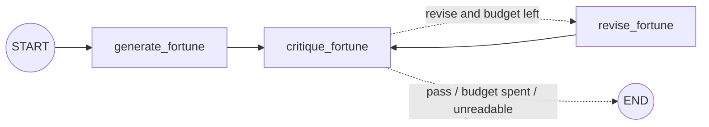

# LangGraph Two-Call Workflow — Extension Plan

**Goal** ([roadmap](../../raw/roadmaps/2026-10-18-ai-infra-project-roadmap.md)): go from basic state graphs
to a **robust two-call workflow** with explicit State, Nodes and Edges, and document the state schema,
graph compilation, and execution-trace handling.

**Re-targeted on 2026-10-18 to your actual notebook,**
[`LangChain_LangGraph_Demo.ipynb`](../../problem_first_ai/LangChain_LangGraph_Demo.ipynb)
(review: [notebook review](langchain-langgraph-demo.md)). The first version of this plan assumed a
messages-only quickstart. Your notebook is well past that, so every step below builds on objects you
already have: `model`, `fortune_prompt`, `generate_fortune`, cell 32's `builder`, and the sentiment graph.
All code uses your style: `ChatPromptTemplate`, the global `model`, and `TypedDict` state.

**Runnable companion:** [`labs/langgraph-two-call/fortune_extension.ipynb`](../../labs/langgraph-two-call/fortune_extension.ipynb).
It holds every step as cells, and `OFFLINE = True` by default spends no credits. On 2026-10-18 it was
executed in a real kernel: all 28 cells ran and every check passed. `test_notebook.py` re-runs it.
Paste the *Helpers* cell and any step into your notebook after cell 50, or run the companion on its own.

## Where you are

| Already in your notebook | Cells |
|---|---|
| `TypedDict` state with named fields | 15, 30, 38 |
| Nodes that return only the keys they change | 17, 30, 40 |
| Sequential edges, `START`/`END`, `compile()` | 19, 32 |
| Conditional edge with a path map | 42 |
| Diagrams, `stream_mode="values"`, `ainvoke` | 21/34/44, 24, 26/50 |
| Arize tracing (OpenInference) | 28, 52 |
| **Classify → respond** pattern | 38–50 |
| Sequential two-call (fortune → joke), the shape of **generate → critique** | 30–36 |

Not yet: `stream_mode="updates"`, checkpointers / `thread_id` / state history, structured output, retry
policies, loops and `recursion_limit`, tests.

## The plan at a glance

| Step | Builds on | Adds | Model calls |
|---|---|---|---|
| [1 Offline harness](#step-1--an-offline-test-harness) | cells 32, 42, 50 | fake `model`, prompt recorder, asserts | 0 |
| [2 Harden the router](#step-2--harden-the-router) | cells 38–42 | validation in the node, `RetryPolicy` | 0 to test |
| [3 Generate → critique](#step-3--generate-then-critique) | cell 30 (`generate_fortune` reused), cell 7's brief | structured rubric via `with_structured_output` | 2 per run |
| [4 Trace handling](#step-4--execution-trace-handling) | cell 32's `builder`, cell 28 | updates stream, checkpointer, history, Arize session | 2 per run |
| [5 Reflection loop](#step-5--bounded-reflection-loop) | steps 3 + cell 42's skill | conditional loop, budget, `recursion_limit` | ≤ 6 per run |
| [6 Concurrency](#step-6--make-cell-50-actually-concurrent) | cell 50 | `asyncio.gather`, `return_exceptions` | same calls, about half the time |
| [7 Sovereign A/B](#step-7--point-it-at-a-sovereign-model) | cell 5 | the same cells against a local vLLM model | local |

## Step 1 — An offline test harness

Every node in your notebook looks up the global `model` **when it runs**. So temporarily swapping
`model` for a fake tests your real cells unchanged, with zero credits spent. A callback that records
each prompt proves that node 2 received node 1's output.

```python
from contextlib import contextmanager
from langchain_core.callbacks import BaseCallbackHandler
from langchain_core.language_models.fake_chat_models import GenericFakeChatModel
from langchain_core.messages import AIMessage

class FakeModel(GenericFakeChatModel):
    """Scripted replies; bind_tools is a no-op so with_structured_output works offline."""
    def bind_tools(self, tools, **kwargs):
        return self

def tool_reply(name, **args):
    """A scripted structured reply: the model 'calling' the schema named `name`."""
    return AIMessage("", tool_calls=[{"name": name, "args": args, "id": "call_1"}])

@contextmanager
def fake_model(*replies):
    """Swap the global `model` for scripted replies; restore the real one afterwards."""
    global model
    msgs = [r if isinstance(r, AIMessage) else AIMessage(r) for r in replies]
    real, model = model, FakeModel(messages=iter(msgs))
    try:
        yield
    finally:
        model = real

class PromptRecorder(BaseCallbackHandler):
    def __init__(self):
        self.prompts = []
    def on_chat_model_start(self, serialized, messages, **kwargs):
        self.prompts.append(messages[0][-1].content)

rec = PromptRecorder()
with fake_model("FORTUNE-XYZ", "JOKE-1"):
    out = graph.invoke({"question": "q?"}, {"callbacks": [rec]})
assert out == {"question": "q?", "fortune": "FORTUNE-XYZ", "joke": "JOKE-1"}
assert "FORTUNE-XYZ" in rec.prompts[1]                  # the handoff, proven

with fake_model("sad", "COMFORT"):
    assert (await sentiment_graph.ainvoke({"sentence": "s"}))["message"] == "COMFORT"
```

Why `bind_tools` is overridden: plain `GenericFakeChatModel.with_structured_output` raises
`NotImplementedError`. ChatOpenRouter's default structured-output method is a forced tool call, and
`tool_reply(...)` replays exactly that path. In your notebook, run this **before cell 28**, or the
fake runs will show up as spans in your Arize project.

## Step 2 — Harden the router

**What breaks.** Cell 40 only does `.strip().lower()`, so any reply other than exactly `happy` or `sad`
reaches the path map, and LangGraph raises a bare `KeyError: 'happy.'`. The traceback adds only "During
task with name 'analyze_sentiment'". That covers `"Happy."`, `"**happy**"`, `"neutral"`, `"positive"` and
`""`. Typing `sentiment` as `Literal["happy", "sad"]` doesn't help on its own, because `TypedDict` values
aren't checked at runtime; it only documents the contract and adds an enum to the schema.

**Fix: validate inside the node, then let LangGraph re-ask.**

```python
import re
from typing import Literal
from langgraph.types import RetryPolicy

class SentimentState(TypedDict):
    sentence: str
    sentiment: Literal["happy", "sad"]   # documents the contract; not enforced at runtime
    message: str

def analyze_sentiment(state: SentimentState) -> dict:
    prompt = sentiment_prompt.invoke({"sentence": state["sentence"]})
    reply = model.invoke(prompt).text
    label = re.sub(r"[^a-z]", "", reply.lower())   # "Happy." / "**happy**" / " HAPPY\n" -> "happy"
    if label not in ("happy", "sad"):                 # "not happy" -> "nothappy" -> rejected, not misrouted
        raise ValueError(f"Classifier replied {reply!r}; expected 'happy' or 'sad'")
    return {"sentiment": label}

def route_sentiment(state: SentimentState) -> Literal["happy", "sad"]:
    return state["sentiment"]

sentiment_builder = StateGraph(SentimentState)
sentiment_builder.add_node(
    "analyze_sentiment",
    analyze_sentiment,
    retry_policy=[RetryPolicy(max_attempts=3, retry_on=ValueError), RetryPolicy()],
)
# ... happy_response / sad_response nodes and the edges exactly as in cell 42, then:
sentiment_graph = sentiment_builder.compile()
```

- **Why validate in the node.** If the node raises, nothing gets written to state. That matters once a
  checkpointer is added: a crash *after* writing leaves a thread that looks finished
  (`next == ()`) but has no `message`.
- **Why two policies.** LangGraph's default `retry_on` returns `False` for `ValueError`, `TypeError` and
  `LookupError` (which includes `KeyError`), so a bare `RetryPolicy(max_attempts=3)` would *not* retry this
  failure. The first policy re-asks on `ValueError`; the second keeps the default retries for transient
  errors such as 429s and dropped connections. Backoff is 0.5 s, doubling each time, plus up to 1 s
  of random jitter: the first retry waits 0.5–1.5 s, and a persistent failure raises after about
  1.5–3.5 s.
- **It still fails loudly** if the model keeps answering off-list: you get a clear `ValueError` after 3
  calls.
- **Re-run the builder.** Redefining `analyze_sentiment` alone leaves the compiled graph on the old node.
- Once Step 3 has introduced `with_structured_output`, the classifier can use a
  `Literal["happy", "sad"]` schema too. ChatOpenRouter sends it as a forced tool call with an enum.

Regression checks (in the companion): `"Happy."` routes to happy; `"neutral"` followed by `"sad"` routes to
sad after 3 model calls; a persistent off-list reply raises `ValueError`.

## Step 3 — Generate, then critique

This has the same shape as fortune → joke, but node 2 **judges** node 1 instead of riffing on it.
`generate_fortune` (cell 30) is reused unchanged. The rubric checks the brief already in cell 7's
system prompt: funny, slightly exaggerated, insightful, 1–2 sentences.

```python
from pydantic import BaseModel, Field

class FortuneCritique(BaseModel):
    score: int = Field(ge=1, le=10, description="How well the fortune meets the brief, 1-10")
    funny: bool
    insightful: bool
    fix: str = Field(description="The single most useful change to make")
    verdict: Literal["pass", "revise"]

class CritiqueState(TypedDict, total=False):
    question: str
    fortune: str            # written by generate_fortune (cell 30, reused as-is)
    critique: dict          # written by critique_fortune
    critique_error: str     # set instead of crashing when the critic's reply can't be parsed

critique_prompt = ChatPromptTemplate([
    ("system", "You are a tough editor of fortune-teller replies. The brief: funny, slightly "
               "exaggerated, but insightful, 1-2 sentences. Score the fortune against the brief. "
               "Use verdict 'revise' when the score is below 7."),
    ("human", "Question: {question}\n\nFortune to review: {fortune}"),
])

def critique_fortune(state: CritiqueState) -> dict:
    critic = model.with_structured_output(FortuneCritique, include_raw=True)   # bound per call
    prompt = critique_prompt.invoke({"question": state["question"], "fortune": state["fortune"]})
    out = critic.invoke(prompt)
    if out["parsed"] is None:   # parsing_error is None when the model answered in prose
        reason = out["parsing_error"] or f"no structured reply: {out['raw'].text[:80]!r}"
        return {"critique_error": str(reason)[:200]}
    return {"critique": out["parsed"].model_dump(), "critique_error": ""}

critique_builder = StateGraph(CritiqueState)
critique_builder.add_node("generate_fortune", generate_fortune)
critique_builder.add_node("critique_fortune", critique_fortune)
critique_builder.add_edge(START, "generate_fortune")
critique_builder.add_edge("generate_fortune", "critique_fortune")
critique_builder.add_edge("critique_fortune", END)
critique_graph = critique_builder.compile()
```

- **State schema.** There is one writer per key. The raw failure reason goes in `critique_error`, next to
  the parsed rubric, so a bad reply is visible in state rather than raised.
- **Bind the critic inside the node.** A critic built at cell level keeps the *real* model, so it spends
  credits even inside `fake_model(...)`.
- **The prose-reply trap.** With `include_raw=True`, a reply that skips the tool call gives
  `parsed=None` *and* `parsing_error=None`. A naive `str(parsing_error)` would record `"None"`.
- Scores outside 1–10, missing fields and unknown tool names all land in `critique_error`.

## Step 4 — Execution trace handling

You already have one layer, Arize, which records prompts, replies and timings per model call. Two more
layers answer different questions:

| Layer | Answers | How |
|---|---|---|
| Arize spans (cell 28) | What did each model call see and return, and how long did it take? | already on |
| `stream_mode="updates"` | What did each node write, as it happened? | yields `{node: its update}` |
| Checkpointer + `thread_id` | What was the full state at every step, after the fact? | `get_state` / `get_state_history` |

```python
from langgraph.checkpoint.memory import InMemorySaver

traced_graph = builder.compile(checkpointer=InMemorySaver())     # cell 32's builder, now with memory
config = {"configurable": {"thread_id": "fortune-run-1"}}

for step, update in enumerate(traced_graph.stream({"question": question}, config, stream_mode="updates"), 1):
    for node, delta in update.items():
        print(f"[step {step}] {node} wrote {list(delta)}: {str(delta)[:60]}")

history = list(traced_graph.get_state_history(config))           # newest first
for snap in reversed(history):
    print(snap.metadata["step"], "next:", snap.next, "keys:", list(snap.values))

before_joke = next(s for s in history if s.next == ("generate_joke",))
print("generate_joke read fortune =", str(before_joke.values["fortune"])[:40])
```

Output from the companion's offline run:

```
[step 1] generate_fortune wrote ['fortune']: {'fortune': 'FORTUNE-FOR-TRACE'}
[step 2] generate_joke wrote ['joke']: {'joke': 'JOKE-FOR-TRACE'}
-1 next: ('__start__',) keys: []
0 next: ('generate_fortune',) keys: ['question']
1 next: ('generate_joke',) keys: ['question', 'fortune']
2 next: () keys: ['question', 'fortune', 'joke']
generate_joke read fortune = FORTUNE-FOR-TRACE
```

**The `thread_id` doubles as the Arize session.** OpenInference copies it into every span of the run as
`session.id`: the graph root, each node, and the prompt and model child spans. Runs without a config (your
cells 36, 46, 48 and 50) have `session.id = None`. Use one `thread_id` per logical run, and Arize's
Sessions view will line up with `get_state_history`. More in [LLM tracing](../concepts/llm-tracing.md).

## Step 5 — Bounded reflection loop

This combines your two skills, sequential edges (cell 32) and a conditional edge (cell 42), into
generate → critique → (revise → critique)* → end.

```python
MAX_REVISIONS = 2
LOOP_LIMITS = {"recursion_limit": 12}   # pass on every call: LangGraph's default is 10,007

class ReflectState(CritiqueState, total=False):
    revisions: int

revise_prompt = ChatPromptTemplate([
    ("system", fortune_prompt.messages[0].prompt.template),        # same persona as cell 7
    ("human", "Question: {question}\nYour last fortune: {fortune}\n"
              "Editor's note: {fix}\nRewrite the fortune to address the note."),
])

def revise_fortune(state: ReflectState) -> dict:
    prompt = revise_prompt.invoke({"question": state["question"], "fortune": state["fortune"],
                                   "fix": state["critique"]["fix"]})
    return {"fortune": str(model.invoke(prompt).text), "revisions": state.get("revisions", 0) + 1}

def start_fortune(state: ReflectState) -> dict:
    # cell 30's node + a reset of the per-run fields (a checkpointer keeps them per thread_id)
    return {**generate_fortune(state), "revisions": 0, "critique": None, "critique_error": ""}

def after_critique(state: ReflectState) -> Literal["revise_fortune", "__end__"]:
    c = state.get("critique")
    if state.get("critique_error") or c is None:
        return END                                     # can't act on a review we couldn't read
    if (c["verdict"] == "revise" or c["score"] < 7) and state.get("revisions", 0) < MAX_REVISIONS:
        return "revise_fortune"
    return END

reflect_builder = StateGraph(ReflectState)
reflect_builder.add_node("generate_fortune", start_fortune)
reflect_builder.add_node("critique_fortune", critique_fortune)
reflect_builder.add_node("revise_fortune", revise_fortune)
reflect_builder.add_edge(START, "generate_fortune")
reflect_builder.add_edge("generate_fortune", "critique_fortune")
reflect_builder.add_conditional_edges("critique_fortune", after_critique)   # targets read from the Literal
reflect_builder.add_edge("revise_fortune", "critique_fortune")              # the loop back
reflect_graph = reflect_builder.compile(checkpointer=InMemorySaver())

reflect_graph.invoke({"question": question}, {"configurable": {"thread_id": "reflect-1"}, **LOOP_LIMITS})
```



- **Three bounds.** `MAX_REVISIONS = 2` caps a run at **6 model calls** (1 generate, 3 critiques,
  2 revisions). The router also stops on an unreadable critique. And `recursion_limit` is the backstop.
  LangGraph's default limit is 10,007 steps, so pass it on **every** call. In testing, a loop with a
  broken budget and no limit kept calling the model until the test's 402 scripted replies ran out.
- **The router trusts the score as well as the verdict,** so an inconsistent "pass with score 3" still
  gets revised.
- **Reset per run.** Without `start_fortune`'s reset, a reused `thread_id` would carry `revisions` (no budget
  left) and the old `critique` over into the next run.
- **No path map here.** `add_conditional_edges` reads the targets from the router's `Literal` return
  annotation, so those values must be node names (or `"__end__"`).

Companion checks: passes after 1 revision in 4 calls; never passes and stops at the budget after 6 calls; a
garbled critique stops after 2 calls; a reused thread gets a fresh budget.

## Step 6 — Make cell 50 actually concurrent

`await a` followed by `await b` runs the second graph only after the first finishes, so cell 50 takes as
long as cells 46 and 48 combined. `asyncio.gather` overlaps the two and keeps the `ainvoke` you're learning:

```python
import asyncio

inputs = [{"sentence": "I got the job! I'm so excited!"},
          {"sentence": "I failed my exam and feel terrible."}]
results = await asyncio.gather(*(sentiment_graph.ainvoke(x) for x in inputs), return_exceptions=True)
for x, r in zip(inputs, results):
    print(x["sentence"][:32], "->", r if isinstance(r, Exception) else (r["sentiment"], r["message"]))
```

- `return_exceptions=True` keeps one bad input from losing the other's result. `await sentiment_graph.abatch(inputs)`
  is equivalent and returns results in input order.
- If the graph has a checkpointer, give **each input its own `thread_id`**. With one shared config the two
  runs interleave in a single thread's history.
- Your `def` nodes run in a thread pool under `ainvoke`, capped at `min(32, cpu_count + 4)`. That's fine
  here. `async def` nodes would lift the cap, but they break the plain `invoke()` in cells 46/48 unless you
  switch those cells to `await ... ainvoke(...)`.

## Step 7 — Point it at a sovereign model

Change only how `model` is created, and every node, test and graph above stays the same. That makes this
notebook a ready-made A/B harness for [project 06](../projects/06-sovereign-ai-engine.md):

```python
model = init_chat_model("<served-model-name>", model_provider="openai",
                        base_url="http://localhost:8000/v1", api_key="EMPTY", max_tokens=4000)
```

**Structured output takes a different path here.** `ChatOpenAI` defaults to `method="json_schema"` (a
`response_format`), while ChatOpenRouter uses a forced tool call. Either confirm the server supports
JSON-schema structured outputs (vLLM does), or bind with
`model.with_structured_output(FortuneCritique, method="function_calling", include_raw=True)` and enable tool
calling on the server. The offline fake only exercises the tool-call path, so make **one real structured
call** against the local server before trusting a comparison. For small local models without either
capability, a text-parse fallback still helps; see the reference implementation below.

Run the same question set against the frontier and local models, and compare critique scores, P95 latency
in Arize, and cost. Treat critique scores as a rough signal until the judge is calibrated
([LLM evaluation](../concepts/llm-evaluation.md)).

## Reference implementation

[`labs/langgraph-two-call/two_call.py`](../../labs/langgraph-two-call/two_call.py) packages the same two
patterns as a module, with 9 offline tests and a CLI. It has a provider-agnostic `chat(system, user)` seam
and asks for JSON with a tolerant parser instead of tool calls, which is the fallback for Step 7's small
models. To drive it with your model:
`chat = lambda s, u: str(model.invoke([("system", s), ("user", u)]).text)`. It's useful once graphs outgrow
the notebook; it isn't the learning path.

## Done when

- [ ] Steps 1–5 are pasted into your notebook (after cell 50), and the offline checks pass.
- [ ] One real run of Step 3 and Step 5, inspected in Arize under its `thread_id` session.
- [ ] Cell 50 replaced with Step 6; real timings recorded in a `raw/story-updates/` note.
- [ ] Step 7 run against a local model on [project 02](../projects/02-k8s-vllm-serving.md), with one real
      structured call confirmed.

## Sources

- [AI infra project roadmap (2026-10-18)](../../raw/roadmaps/2026-10-18-ai-infra-project-roadmap.md): learning track, the four canonical patterns, deliverables.
- [`problem_first_ai/LangChain_LangGraph_Demo.ipynb`](../../problem_first_ai/LangChain_LangGraph_Demo.ipynb): the baseline every step builds on (cell numbers above).
- Verified 2026-10-18 against langgraph 1.2.16 / langchain-core 1.6.12 / langchain-openrouter 0.2.9 by
  independent reproduction, and by executing the companion notebook.
