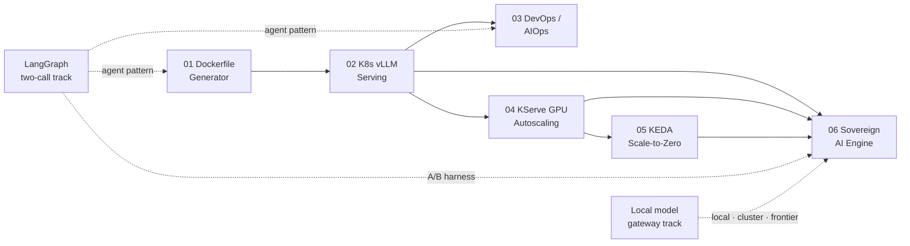

# Overview — AI Infrastructure & Sovereign AI Roadmap

Six projects build one platform: ship containers, serve models on Kubernetes,
operate them, scale them, scale them to zero, and finally decide — with
numbers — when a private open-weight model beats a frontier API
([roadmap](../raw/roadmaps/2026-10-18-ai-infra-project-roadmap.md),
[Sovereign AI blueprint](../raw/roadmaps/2026-10-18-sovereign-ai-engine-blueprint.md)).
A parallel LangGraph learning track supplies the agent patterns. A local model gateway track
supplies the routing layer that 06 compares through.

## The measurement chain

The projects are linked by numbers, not just by order. Each one produces a
measurement the next one consumes:

1. **[02](projects/02-k8s-vllm-serving.md)** measures the per-GPU concurrency
   **knee** and sustained req/s at SLO.
2. **[04](projects/04-kserve-gpu-autoscaling.md)** uses the knee as its
   autoscaling `scaleTarget`.
3. **[05](projects/05-keda-scale-to-zero.md)** measures the **cold-start
   budget** that decides which models may scale to zero.
4. **[06](projects/06-sovereign-ai-engine.md)** feeds sustained capacity, idle
   cost and quality into the **volume crossover**.

Change the model, the precision or a vLLM knob and the chain re-runs — which is
why every measurement goes into a dated `raw/story-updates/` note.

## Concept map

| Concept | 01 | 02 | 03 | 04 | 05 | 06 |
|---|---|---|---|---|---|---|
| [KV cache](concepts/kv-cache.md) | | ● | ○ | ● | | ● |
| [Continuous batching](concepts/continuous-batching.md) | | ● | | ● | | ● |
| [GPU scheduling](concepts/gpu-scheduling.md) | | ● | | ● | ● | ○ |
| [Cold starts](concepts/cold-starts.md) | ○ | ○ | | ● | ● | |
| [PEFT (LoRA/QLoRA)](concepts/parameter-efficient-finetuning.md) | | ○ | | | | ● |
| [Quantization](concepts/quantization.md) | | ○ | | | ○ | ● |
| [LLM evaluation](concepts/llm-evaluation.md) | ● | ● | ○ | | | ● |
| [LangGraph state graphs](concepts/langgraph-state-graphs.md) | ● | | ● | | | ○ |
| [LLM tracing](concepts/llm-tracing.md) | | ○ | ● | | | ○ |

● central · ○ touches

## Learning track

Your Problem-First AI course notebook
([review](notebooks/langchain-langgraph-demo.md)) already covers state, nodes, edges,
conditional routing, async and Arize tracing, and implements classify → respond. The
[extension plan](notebooks/langgraph-two-call-extension.md) builds on those exact cells:
a hardened router, generate → critique with a structured rubric, trace handling,
a bounded reflection loop, concurrency, and a sovereign-model A/B. It ships as an
offline-runnable companion notebook in `labs/langgraph-two-call/`.

## Local model gateway track

A LiteLLM gateway gives one front door to models in three tiers
([plan](synthesis/2026-10-20-local-model-gateway-plan.md),
[decisions](../raw/inbox/2026-10-20-local-model-gateway-decisions.md)):

- **`local`**: this Mac, the dev loop where aliases and the validator are built and checked.
- **`cluster`**: Kubernetes on your own NVIDIA hardware, where capacity and utilization are
  measured.
- **`frontier`**: a vendor API, the baseline.

It feeds [06](projects/06-sovereign-ai-engine.md). Comparing the same role across all three tiers
is *Planned*. So is pricing 06's crossover against cloud GPUs while utilization is recorded on the
owned cluster. The first slice is one `local` alias, being built on 2026-10-20. The track's plan
conflicts with the stack 06 assumed; see the callout on the
[project 06 page](projects/06-sovereign-ai-engine.md).

## Where things stand (2026-10-18)

All six projects are **draft** — compiled from plans, no measurements yet.
Stories for each are seeded in the [story bank](../story-bank/index.md) with
`TBD` results. The first evidence to collect: the project 02 knee. On the learning
track, fix the notebook's housekeeping first: rotate the leaked key prefixes, then use the
`.venv` kernel ([review](notebooks/langchain-langgraph-demo.md#fix-first-in-this-order)).

## Sources

- [AI infra project roadmap (2026-10-18)](../raw/roadmaps/2026-10-18-ai-infra-project-roadmap.md)
- [Sovereign AI Engine blueprint — Aish's framework (2026-10-18)](../raw/roadmaps/2026-10-18-sovereign-ai-engine-blueprint.md)
- [Local model gateway decisions (2026-10-20)](../raw/inbox/2026-10-20-local-model-gateway-decisions.md)
