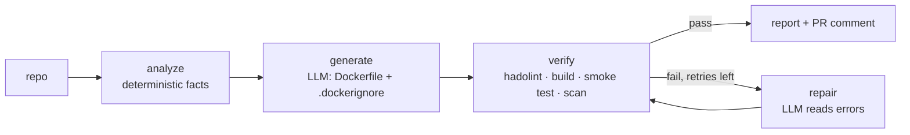

# 01 — Dockerfile Generator

**Roadmap position** ([overview](../overview.md)): first ([source](../../raw/roadmaps/2026-10-18-ai-infra-project-roadmap.md)).
It produces the images every later project ships, and it is the first real
agent built on the [LangGraph two-call pattern](../notebooks/langgraph-two-call-extension.md).

Only the title was stated in the source; the design below is **Proposed**.

## Proposed architecture

An agent that reads a repository, writes a production-grade Dockerfile, and
**proves it by building it**. The build log, not the model, is the critic.

| Stage | Kind | Output into state |
|---|---|---|
| analyze | code | `facts`: language, runtime version, package manager, entrypoint, port, system deps |
| generate | LLM call 1 | `dockerfile`, `dockerignore` |
| verify | tools | `lint_findings`, `build_log`, `smoke_ok`, `cves`, `image_mb` |
| repair | LLM call 2 (loop) | revised `dockerfile`, `attempts += 1` |

This is the *generate → critique* graph from the notebook track with the
critique node swapped for real tools — see
[step 7 of the extension plan](../notebooks/langgraph-two-call-extension.md#step-7--loop-on-the-critique-reflection).

## Design decisions (Proposed)

- **Facts-first prompting.** The LLM sees a compact facts JSON from the
  analyzer (manifests, lockfiles, entrypoint), not the raw repo. Smaller
  prompts, fewer invented dependencies, reproducible inputs for evals.
- **Tool-grounded critic over LLM-only critic.** "Does it build, start, and
  pass health?" is objective. An LLM critic is only used to *explain* a failure.
- **Image policy baked into the prompt and checked by lint:** multi-stage
  builds, slim/distroless runtime, base images pinned by digest, non-root
  `USER`, `HEALTHCHECK`, no secrets in layers, BuildKit cache mounts.
- **GPU images are a special case.** For [vLLM serving](02-k8s-vllm-serving.md)
  the right move is the thin layer on top of the official serving image, not a
  generated CUDA stack. The generator should recognise this and say so.
- **Bounded repair loop** (e.g. 3 attempts) with the full attempt history in
  state, so failures are debuggable from the trace.

## Stack

Python · LangGraph · Docker BuildKit · hadolint · Trivy (or Grype) ·
GitHub Actions (later: a PR bot that proposes a Dockerfile).

## Evaluation

Build a corpus of ~20–30 repos across Python/Node/Go/Java with hand-written
reference Dockerfiles.

| Metric | Why |
|---|---|
| Build success, first try / after repair | Core usefulness |
| Mean repair iterations to green | Cost and latency of the loop |
| Image size vs reference | Quality of the multi-stage output |
| Critical/high CVEs vs reference | Security posture |
| hadolint findings | Best-practice adherence |

## Milestones

1. Deterministic analyzer for Python + Node.
2. Generate + build loop (LangGraph, repair bounded).
3. Smoke test + scan + size report.
4. GitHub Action that comments a proposed Dockerfile on PRs.

## Open questions

- Which model: frontier API or the [sovereign model](06-sovereign-ai-engine.md)?
  This repo's corpus is a ready-made eval set for the sovereign track.
- Sandbox for running untrusted builds (rootless BuildKit, ephemeral runners).

## Story

[story-bank/stories/dockerfile-generator.md](../../story-bank/stories/dockerfile-generator.md)

## Sources

- [AI infra project roadmap (2026-10-18)](../../raw/roadmaps/2026-10-18-ai-infra-project-roadmap.md) — project title and sequence.
