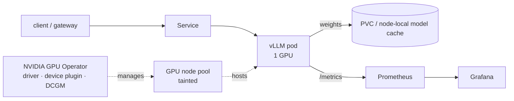

# 02 — Kubernetes vLLM Serving

**Roadmap position** ([overview](../overview.md)): second ([source](../../raw/roadmaps/2026-10-18-ai-infra-project-roadmap.md)).
The serving substrate for everything after it: [KServe](04-kserve-gpu-autoscaling.md)
wraps it, [KEDA](05-keda-scale-to-zero.md) scales it, the
[Sovereign AI Engine](06-sovereign-ai-engine.md) benchmarks on it.

Only the title was stated in the source; the design below is **Proposed**.

## Goal

Serve an open-weight model on Kubernetes through vLLM's OpenAI-compatible API,
observable enough to find the concurrency at which latency falls off a cliff.

## Proposed architecture



- **GPU node pool**, tainted so only GPU workloads land there
  ([GPU scheduling](../concepts/gpu-scheduling.md)).
- **NVIDIA GPU Operator** installs driver, container toolkit, device plugin
  (`nvidia.com/gpu` resource) and the DCGM exporter (GPU metrics).
- **vLLM Deployment**, one GPU per replica to start; tensor parallelism only
  when the model doesn't fit.
- **Model cache** on a PVC or node-local NVMe so restarts don't re-download
  weights ([cold starts](../concepts/cold-starts.md)).
- **Probes:** a long `startupProbe` (weight loading takes minutes), then
  `readinessProbe` on `/health`.

## Minimal manifest (Proposed — pin versions before use)

```yaml
apiVersion: apps/v1
kind: Deployment
metadata:
  name: vllm-small
spec:
  replicas: 1
  selector: {matchLabels: {app: vllm-small}}
  template:
    metadata: {labels: {app: vllm-small}}
    spec:
      tolerations:
        - {key: nvidia.com/gpu, operator: Exists, effect: NoSchedule}
      containers:
        - name: vllm
          image: vllm/vllm-openai:<pinned-tag>
          args:
            - --model=<hf-org>/<2-4B-model>
            - --max-model-len=8192
            - --gpu-memory-utilization=0.90
            - --max-num-seqs=64
          ports: [{containerPort: 8000}]
          env:
            - name: HF_TOKEN
              valueFrom: {secretKeyRef: {name: hf-token, key: token}}
          resources:
            limits: {nvidia.com/gpu: 1}
          volumeMounts:
            - {name: model-cache, mountPath: /root/.cache/huggingface}
            - {name: dshm, mountPath: /dev/shm}
          startupProbe:
            httpGet: {path: /health, port: 8000}
            periodSeconds: 10
            failureThreshold: 60      # allow ~10 min for weights + engine init
          readinessProbe:
            httpGet: {path: /health, port: 8000}
            periodSeconds: 5
      volumes:
        - name: model-cache
          persistentVolumeClaim: {claimName: hf-model-cache}
        - name: dshm                  # shared memory for NCCL / tensor parallel
          emptyDir: {medium: Memory, sizeLimit: 2Gi}
```

## The knobs that matter

| vLLM flag | What it trades | Concept |
|---|---|---|
| `--gpu-memory-utilization` | Fraction of VRAM vLLM pre-allocates; what's left after weights becomes KV cache | [KV cache](../concepts/kv-cache.md) |
| `--max-model-len` | Longest sequence; caps per-request KV footprint | [KV cache](../concepts/kv-cache.md) |
| `--max-num-seqs` | Max concurrent sequences in a batch: throughput vs per-request latency | [Continuous batching](../concepts/continuous-batching.md) |
| `--max-num-batched-tokens` | Token budget per scheduler step; interacts with chunked prefill | [Continuous batching](../concepts/continuous-batching.md) |
| `--quantization`, `--kv-cache-dtype` | Memory vs precision | [Quantization](../concepts/quantization.md) |
| `--enable-lora` | Serve LoRA adapters on one base model | [PEFT](../concepts/parameter-efficient-finetuning.md) |
| `--tensor-parallel-size` | Split a model across GPUs (needs `/dev/shm`) | [GPU scheduling](../concepts/gpu-scheduling.md) |

## Observability

Scrape vLLM's `/metrics`. The series to dashboard (exact names drift between
vLLM releases — check your `/metrics` output):

- `vllm:num_requests_running`, `vllm:num_requests_waiting` — saturation; the
  waiting queue is the best autoscaling signal ([04](04-kserve-gpu-autoscaling.md)).
- KV-cache usage percentage — near 100% means preemption is coming.
- `vllm:time_to_first_token_seconds`, per-output-token latency,
  `vllm:e2e_request_latency_seconds` — histograms → P50/P95/P99.
- Prompt/generation token counters — throughput in tokens/s.
- DCGM: GPU utilization, memory used, power, SM clocks.

## Evaluation — find the knee

Run a concurrency sweep (e.g. 1, 2, 4 … 128) with `vllm bench serve` or a
load tool from [LLM evaluation](../concepts/llm-evaluation.md); plot TTFT P95
and output tokens/s against concurrency. The **knee** — where throughput
flattens and TTFT P95 climbs — is the per-replica concurrency target that
project 04 autoscales on. Record it in a `raw/story-updates/` note.

## Milestones

1. Single-GPU deployment serving a 2–4B model; curl the OpenAI API.
2. Prometheus + Grafana dashboard for the series above.
3. Concurrency sweep → knee documented.
4. Same sweep with a quantized variant (feeds [06](06-sovereign-ai-engine.md)).

## Story

[story-bank/stories/k8s-vllm-serving.md](../../story-bank/stories/k8s-vllm-serving.md)

## Sources

- [AI infra project roadmap (2026-10-18)](../../raw/roadmaps/2026-10-18-ai-infra-project-roadmap.md) — project title and sequence.
