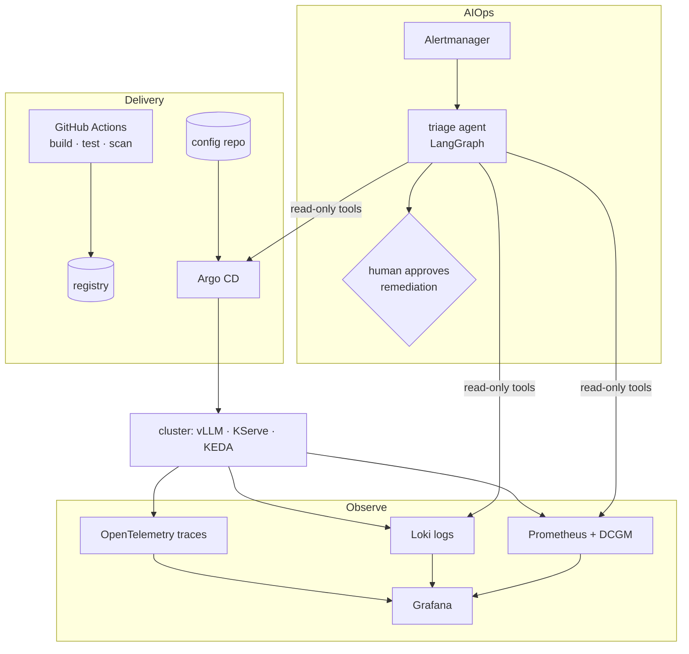

# 03 — DevOps / AIOps Platform

**Roadmap position** ([overview](../overview.md)): third ([source](../../raw/roadmaps/2026-10-18-ai-infra-project-roadmap.md)).
The operating layer around the serving stack: ship it with GitOps, see it with
observability, and run it with an LLM-assisted triage agent.

Only the title was stated in the source; the design below is **Proposed**.

## Proposed architecture

### 1. Delivery
- CI builds images (produced by [01](01-dockerfile-generator.md)), runs tests,
  scans, pushes by digest.
- Argo CD syncs Helm/Kustomize from a config repo; every cluster change is a
  commit — which also gives the triage agent a "what changed recently" tool.

### 2. Observability — golden signals for LLM serving

| Signal | LLM-serving form |
|---|---|
| Latency | TTFT and per-output-token latency, P95/P99 ([evaluation](../concepts/llm-evaluation.md)) |
| Traffic | requests/s **and** tokens/s (prompt vs generated) |
| Errors | 5xx, timeouts, preemptions, OOM restarts |
| Saturation | waiting requests, KV-cache usage ([KV cache](../concepts/kv-cache.md)), GPU memory |

Plus a cost signal: GPU-hours per million generated tokens — the number the
[Sovereign AI crossover](06-sovereign-ai-engine.md#crossover-analysis) needs.

### 3. AIOps triage agent

A LangGraph graph built from the
[classify → respond pattern](../notebooks/langgraph-two-call-extension.md#variant-b--classify-then-respond-with-a-conditional-edge):

1. **Classify** the alert: component (serving / autoscaling / node / network),
   severity, likely blast radius.
2. **Gather** evidence with read-only tools: PromQL queries, recent logs,
   recent Argo CD syncs, pod events.
3. **Respond** with an incident summary, the most likely cause, and the next
   runbook step — routed by severity (page a human vs post to a channel).
4. **Remediate only behind approval:** write actions (rollback, scale) pause on
   a LangGraph `interrupt` until a human approves.

Guardrails: tools are read-only by default; every tool call lands in the trace;
the agent's own latency and accuracy are measured like any other service.

## Evaluation

- Replay a library of past (or injected) incidents; score root-cause accuracy
  and time-to-summary against a human baseline.
- Chaos drills: kill a GPU node, fill the KV cache, push a bad config — does
  the alert fire, and does the agent name the cause?

## Milestones

1. GitOps for projects 02/04/05 manifests.
2. Dashboards + SLO alerts on the golden signals.
3. Triage agent, read-only, posting summaries.
4. Approval-gated remediation for two runbooks (rollback, scale-out).

## Story

[story-bank/stories/devops-aiops-platform.md](../../story-bank/stories/devops-aiops-platform.md)

## Sources

- [AI infra project roadmap (2026-10-18)](../../raw/roadmaps/2026-10-18-ai-infra-project-roadmap.md) — project title and sequence.
