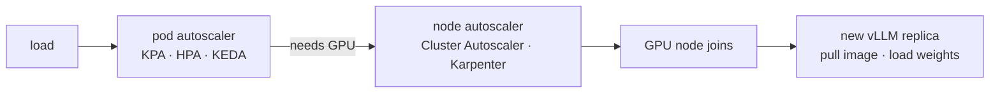

# 04 — KServe GPU Autoscaling

**Roadmap position** ([overview](../overview.md)): fourth ([source](../../raw/roadmaps/2026-10-18-ai-infra-project-roadmap.md)).
Put the [vLLM serving stack](02-k8s-vllm-serving.md) behind KServe and scale
it on signals that actually reflect GPU saturation.

Only the title was stated in the source; the design below is **Proposed**.

## Why the default autoscaler is wrong for GPUs

- **CPU utilization** barely moves on a GPU-bound pod.
- **GPU utilization %** pins near 100% long before vLLM runs out of batch
  capacity — [continuous batching](../concepts/continuous-batching.md) keeps
  absorbing requests until the KV cache is full.
- The signals that track user pain are **concurrency per replica** and the
  **waiting-request queue** (`vllm:num_requests_waiting`), with KV-cache usage
  as an early warning.

## Two levels of scaling



Pod scale-out is useless without a free GPU; node provisioning usually
dominates time-to-scale ([cold starts](../concepts/cold-starts.md),
[GPU scheduling](../concepts/gpu-scheduling.md)).

## KServe modes

KServe can run a predictor on Knative (serverless: the KPA scales on
concurrency or RPS and can scale to zero) or as a plain Kubernetes Deployment
(scaled by HPA or [KEDA](05-keda-scale-to-zero.md)). Mode names and defaults
have changed across releases — check the version you install.

## InferenceService (Proposed — verify fields against your KServe version)

```yaml
apiVersion: serving.kserve.io/v1beta1
kind: InferenceService
metadata:
  name: small-llm
spec:
  predictor:
    minReplicas: 1
    maxReplicas: 4
    scaleMetric: concurrency
    scaleTarget: 16          # set from the knee measured in project 02
    model:
      modelFormat: {name: huggingface}   # Hugging Face runtime, vLLM backend
      args:
        - --model_name=small-llm
        - --model_id=<hf-org>/<2-4B-model>
      resources:
        limits: {nvidia.com/gpu: "1"}
```

**The key link:** `scaleTarget` is not a guess. It is the per-replica
concurrency knee from the [project 02 sweep](02-k8s-vllm-serving.md#evaluation--find-the-knee),
minus headroom. Changing the model, quantization, or `max-num-seqs` moves the
knee, so re-measure after each [Sovereign AI](06-sovereign-ai-engine.md)
optimization.

## Experiments

1. **Step load** (e.g. 2 → 40 concurrent): time until P95 TTFT is back under
   SLO; replicas over time.
2. **Metric comparison:** concurrency (KPA) vs waiting-queue (custom metric via
   Prometheus Adapter or KEDA) vs GPU utilization — which tracks SLO best?
3. **Warm node vs cold node:** time-to-scale with a spare GPU node already up
   vs provisioning from zero.
4. **Cost:** GPU-hours consumed under a daily traffic curve vs fixed peak
   provisioning.

## Milestones

1. KServe installed; InferenceService serving the project 02 model.
2. Concurrency autoscaling with `scaleTarget` from the knee.
3. Queue-depth custom metric autoscaling; compare.
4. GPU node pool autoscaling (Karpenter or Cluster Autoscaler) end to end.

## Story

[story-bank/stories/kserve-gpu-autoscaling.md](../../story-bank/stories/kserve-gpu-autoscaling.md)

## Sources

- [AI infra project roadmap (2026-10-18)](../../raw/roadmaps/2026-10-18-ai-infra-project-roadmap.md) — project title and sequence.
