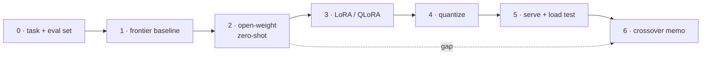

# 06 — Sovereign AI Engine

**Roadmap position** ([overview](../overview.md)): sixth, the capstone. Framework credited to **Aish**
([blueprint](../../raw/roadmaps/2026-10-18-sovereign-ai-engine-blueprint.md)).
It runs on the serving stack built in [02](02-k8s-vllm-serving.md)–[05](05-keda-scale-to-zero.md)
and answers one question with numbers: *when does running our own model beat
renting a frontier API?*

> **Conflict (2026-10-20):** this page places 06 on the Kubernetes stack from 02–05
> ([roadmap](../../raw/roadmaps/2026-10-18-ai-infra-project-roadmap.md)) and proposes phase 2 as
> 2–4B models at bf16 on vLLM. The
> [local model gateway decisions](../../raw/inbox/2026-10-20-local-model-gateway-decisions.md) make
> the Mac the dev loop for phases 0–2. Tonight's lineup there is a general local set (7–14B,
> 4-bit), and 06's 2–4B candidates get their own aliases later. Capacity and utilization are still
> measured on your own Kubernetes cluster, so this narrows the Mac's role rather than replacing the
> 02–05 stack ([ADR 0001](../../problem_first_ai/litellm/docs/adr/0001-mac-is-the-dev-loop.md)).
> To resolve with you: whether this page's phases 0–2 move to the Mac, and at what precision 06's
> 2–4B candidates are compared. Plan: [local model gateway](../synthesis/2026-10-20-local-model-gateway-plan.md).

## From the blueprint

- Run **open-weight models in the 2–4B range** (e.g. Qwen, Gemma, Llama
  families) locally or on private infrastructure.
- Establish a **frontier API baseline** (OpenAI / Anthropic / Gemini) to measure
  the performance gap.
- Close the gap with three optimizations:
  1. **PEFT** with LoRA / QLoRA → [parameter-efficient fine-tuning](../concepts/parameter-efficient-finetuning.md)
  2. **Weight quantization**, evaluating precision vs performance → [quantization](../concepts/quantization.md)
  3. **Inference optimization** via continuous batching and KV caching for high
     concurrency → [continuous batching](../concepts/continuous-batching.md), [KV cache](../concepts/kv-cache.md)
- Judge it on **quality** (rubrics / LLM-as-a-judge), **P95/P99 latency**,
  **throughput**, and the **volume crossover threshold** that justifies leaving
  a closed vendor API → [LLM evaluation](../concepts/llm-evaluation.md),
  [crossover analysis](#crossover-analysis).

Everything below this line is **Proposed** structure for executing the blueprint.

## Phases

| Phase | Do | Exit criterion |
|---|---|---|
| 0 · Task & eval set | Pick 1–2 concrete tasks (e.g. Dockerfile generation from [01](01-dockerfile-generator.md), incident summaries from [03](03-devops-aiops-platform.md)). Build a held-out eval set (100–300 items) + rubric. | Rubric agreed; judge calibrated on ~30 human-labelled items |
| 1 · Frontier baseline | Run the eval set through 1–3 vendor APIs. Record quality, latency, $/request. | Quality ceiling `Q_frontier` known |
| 2 · Open-weight zero-shot | 2–3 models in the 2–4B range at bf16 on vLLM, same prompts. | Gap per model known; pick one or two to carry forward |
| 3 · PEFT | LoRA (r ∈ {8, 16, 32}) and QLoRA (4-bit base) on a task-specific train split. | Gap closed as far as data allows; training cost recorded |
| 4 · Quantization | bf16 → FP8/INT8 → INT4 (AWQ/GPTQ) of the tuned model. | Quality drop vs VRAM and throughput gain charted |
| 5 · Serving optimization | vLLM concurrency sweep; tune `max-num-seqs`, prefix caching, `max-model-len` ([02](02-k8s-vllm-serving.md#the-knobs-that-matter)). | P95/P99 vs concurrency curve; sustained req/s at SLO |
| 6 · Crossover memo | Feed measured capacity + current prices into the calculator. | Go / no-go with the volume threshold |

## Experiment matrix

Track every cell as a row in a results table (a `raw/story-updates/` note per
run, so the numbers are evidenced):

| Model | Adaptation | Precision | Serving config | Quality | P95 TTFT | P99 E2E | Output tok/s | VRAM | $/1k req |
|---|---|---|---|---|---|---|---|---|---|
| frontier API | — | — | vendor | TBD | TBD | TBD | — | — | TBD |
| open model A | none | bf16 | default | TBD | TBD | TBD | TBD | TBD | TBD |
| open model A | LoRA r=16 | bf16 | default | TBD | TBD | TBD | TBD | TBD | TBD |
| open model A | QLoRA → merged | INT4 AWQ | tuned | TBD | TBD | TBD | TBD | TBD | TBD |

**Gap** at each stage: `gap = (Q_frontier − Q_model) / Q_frontier`. The story
this project tells is the gap shrinking stage by stage — and what each
percentage point cost in VRAM, latency, and engineering time.

## Crossover analysis

Monthly cost at volume *V* requests/month:

- **API:** `C_api(V) = V × (T_in × p_in + T_out × p_out)` — linear in volume.
- **Sovereign:** `C_self(V) = G(V) × gpu_month + ops_month`, where
  `G(V) = max(min_gpus, ⌈V / capacity_per_gpu⌉)` — a step function.
- `capacity_per_gpu` = sustained req/s at SLO **from your phase 5 load test**
  × target utilization × seconds per month.

The crossover `V*` is the smallest volume where `C_self ≤ C_api`. With
`min_gpus` GPUs it is simply `V* = (min_gpus × gpu_month + ops_month) / cost_per_request_api`.

**Planned (2026-10-20): price against the cloud, measure on owned hardware.** Scaling up GPUs
means a cloud bill, with your own hardware as the fallback. So `gpu_month` is priced against
**cloud GPUs**, while resource utilization (and the capacity behind `capacity_per_gpu`) is still
recorded on the **owned cluster**
([gateway decisions](../../raw/inbox/2026-10-20-local-model-gateway-decisions.md),
[plan](../synthesis/2026-10-20-local-model-gateway-plan.md)).

**Worked example — _illustrative_ numbers, not quotes or measurements:**
1,000 input + 300 output tokens per request; API at $1.00 / $4.00 per million
input/output tokens → $0.0022 per request. One GPU at $1.20/h → $876/month,
plus $500/month operations. `V* ≈ 1,376 / 0.0022 ≈ 625k requests/month`
(about 0.24 req/s on average). If that GPU sustains 4 req/s at SLO and you
plan for 60% utilization, it serves ~6.3M requests/month — so at full use the
self-hosted marginal cost is ~$0.00014/request, roughly 16× under the API.

Run it with your own numbers:
[`labs/sovereign-ai/crossover.py`](../../labs/sovereign-ai/crossover.py)
(`python3 labs/sovereign-ai/crossover.py --example` reproduces the above).

**The crossover only counts if quality clears the bar.** Decision rule:

1. Quality ≥ threshold (e.g. judge score ≥ 95% of frontier, or pairwise
   win+tie rate ≥ 50% against it), **and**
2. P95/P99 within SLO at expected peak concurrency, **and**
3. Volume ≥ `V*` — *or* a non-cost driver applies: data residency, privacy,
   regulatory control, vendor lock-in, offline operation. Sovereignty can
   justify running below the cost crossover; the memo should say so explicitly.

Hidden costs to put in `ops_month`: engineering time (usually the largest
term), monitoring, storage, re-tuning when the base model is upgraded, and the
idle cost avoided (or not) by [scale-to-zero](05-keda-scale-to-zero.md).

## Stack (Proposed)

Hugging Face Transformers + PEFT + TRL (SFT) · bitsandbytes (QLoRA) ·
AutoAWQ / GPTQ tooling or vLLM's supported quantized checkpoints ·
vLLM on Kubernetes ([02](02-k8s-vllm-serving.md)) · eval harness with an
LLM judge ([evaluation](../concepts/llm-evaluation.md)) · the
[LangGraph two-call graph](../notebooks/langgraph-two-call-extension.md#step-7--point-it-at-a-sovereign-model)
as a ready-made A/B harness between the API and the local model.

## Risks

- **Eval contamination** — tuning data overlapping the eval set inflates gains.
- **Judge bias** — self-preference when the judge shares a family with a
  candidate; length bias. Calibrate against human labels.
- **Quantization cliffs** — INT4 can be fine on average and bad on the tail;
  inspect worst-case items, not just the mean.
- **Throughput measured off-SLO** — capacity must be measured *at* the P95
  target, or the crossover is optimistic.

## Story

[story-bank/stories/sovereign-ai-engine.md](../../story-bank/stories/sovereign-ai-engine.md)

## Sources

- [Sovereign AI Engine blueprint — Aish's framework (2026-10-18)](../../raw/roadmaps/2026-10-18-sovereign-ai-engine-blueprint.md) — goal, baseline, three optimizations, metrics.
- [AI infra project roadmap (2026-10-18)](../../raw/roadmaps/2026-10-18-ai-infra-project-roadmap.md) — position in the sequence.
- [Local model gateway decisions (2026-10-20)](../../raw/inbox/2026-10-20-local-model-gateway-decisions.md) — the Mac as dev loop, crossover priced against cloud GPUs, the conflict above.
