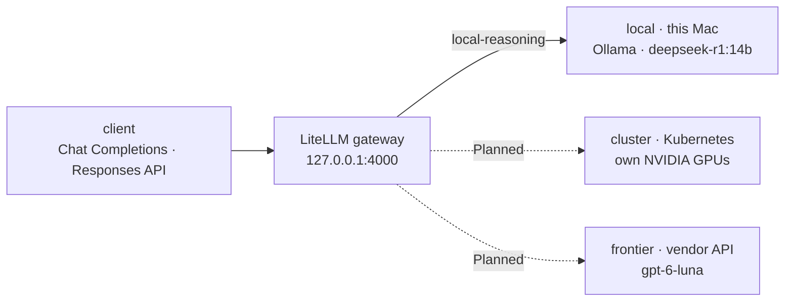

# Local Model Gateway — Plan

A LiteLLM gateway is the routing layer between a frontier API and open-weight models, built in the
direction of [project 06](../projects/06-sovereign-ai-engine.md) (Aish's Sovereign AI Engine
framework). You decided this in a design session on 2026-10-20
([decisions note](../../raw/inbox/2026-10-20-local-model-gateway-decisions.md)). It has two
reasons: to learn LiteLLM, and to run coursework against models other than `gpt-6-luna`.

The vocabulary (gateway, alias, role, tier, candidate, baseline…) is defined in the project's
[GLOSSARY](../../problem_first_ai/litellm/GLOSSARY.md). The two hard-to-reverse decisions are
recorded as ADRs in [`docs/adr/`](../../problem_first_ai/litellm/docs/adr/).

## Tiers and aliases

| Tier | Runs on | Its job |
|---|---|---|
| `local` | This Mac (M3 Pro, 18 GB): Ollama now, vllm-metal later | The dev loop: aliases, cases and the gateway are built and checked here |
| `cluster` | Kubernetes on your own NVIDIA hardware | Where capacity and resource utilization are measured |
| `frontier` | A vendor API (`gpt-6-luna`) | The baseline. Its alias is *Planned* |

The tier split is [ADR 0001](../../problem_first_ai/litellm/docs/adr/0001-mac-is-the-dev-loop.md).
It narrows the Mac's role; it doesn't replace the Kubernetes stack from projects 02–05.

Aliases are named `<tier>-<role>`, where the role is reasoning, text or coding.
[ADR 0002](../../problem_first_ai/litellm/docs/adr/0002-an-alias-promises-a-role.md) says an alias
**promises a role, not a model**, so it can be re-pointed (for example from Ollama to vllm-metal).
Three rules follow:

- Every run records the backend model behind each alias.
- Baselines are keyed by alias plus backend model, and re-pointing an alias starts a new baseline.
- Experiments use *candidates*: aliases pinned to one backend model and never re-pointed.

A baseline is a passing run recorded as a dated `raw/story-updates/` note. That is the only way its
numbers can be cited here.

## Decided

- **First slice** (scope decided; being built on 2026-10-20):
  - One alias, `local-reasoning` → `deepseek-r1:14b` on Ollama 0.40.6.
  - A 4096-token context window, with one model resident at a time.
  - The gateway on `127.0.0.1:4000`, serving both Chat Completions and the Responses API.
  - An end-to-end validator skill that every later change must pass.
- **`deepseek-r1:14b` cannot call tools.** Its Ollama prompt template has no tools section. It can
  serve Assignment 1's query-understanding part, but not the tool or ReAct parts.
- **Supply chain.** LiteLLM is pinned to an exact version with a lockfile: 1.103.3, the newest
  release at least 14 days old. The note's reason is that releases 1.82.7 and 1.82.8 were
  compromised on PyPI in March 2026.
- **Keys.** No key value is written to any file. Only frontier aliases read a key, and they read it
  from the environment.
- **Course material is never published.** `problem_first_ai/preread/` and
  `problem_first_ai/Assignment 1/` stay out of git. This is now enforced in `.gitignore`.

## Planned (not built)

- **Planned:** running the three-model lineup (reasoning, text, coding) one after another moves to
  a future project, not this Mac.
- **Planned:** compare the same role across all three tiers: `gpt-6-luna` (frontier), this Mac,
  and Kubernetes-hosted containers on your own NVIDIA GPUs. On the Mac, the vLLM path is
  vllm-metal.
- **Planned:** capture resource utilization even on owned hardware. Scaling up GPUs means a cloud
  bill, with your own hardware as the fallback. So project 06's
  [crossover](../projects/06-sovereign-ai-engine.md#crossover-analysis) is priced against cloud
  GPUs, while utilization is recorded on the owned cluster.
- **Planned:** add a frontier alias for `gpt-6-luna` that reads its key from the environment.
- **Planned:** keep journaling learnings in `problem_first_ai/litellm/JOURNAL.md` as later
  projects build on this one.

## Where it meets project 06

The note records one conflict with the project 06 page. That page places 06 on the 02–05
Kubernetes stack, with 2–4B models at bf16 on vLLM in phase 2. The note says the Mac is the dev
loop for phases 0–2, and tonight's lineup is a general local set (7–14B, 4-bit). 06's 2–4B
candidates get their own aliases later. The `Conflict` callout on the
[project 06 page](../projects/06-sovereign-ai-engine.md) tracks it until you resolve it.

## Sources

- [Local model gateway — design decisions (2026-10-20)](../../raw/inbox/2026-10-20-local-model-gateway-decisions.md): everything on this page.
- [`problem_first_ai/litellm/GLOSSARY.md`](../../problem_first_ai/litellm/GLOSSARY.md): term definitions.
- [`problem_first_ai/litellm/docs/adr/`](../../problem_first_ai/litellm/docs/adr/): ADR 0001 (the Mac is the dev loop) and ADR 0002 (an alias promises a role).
